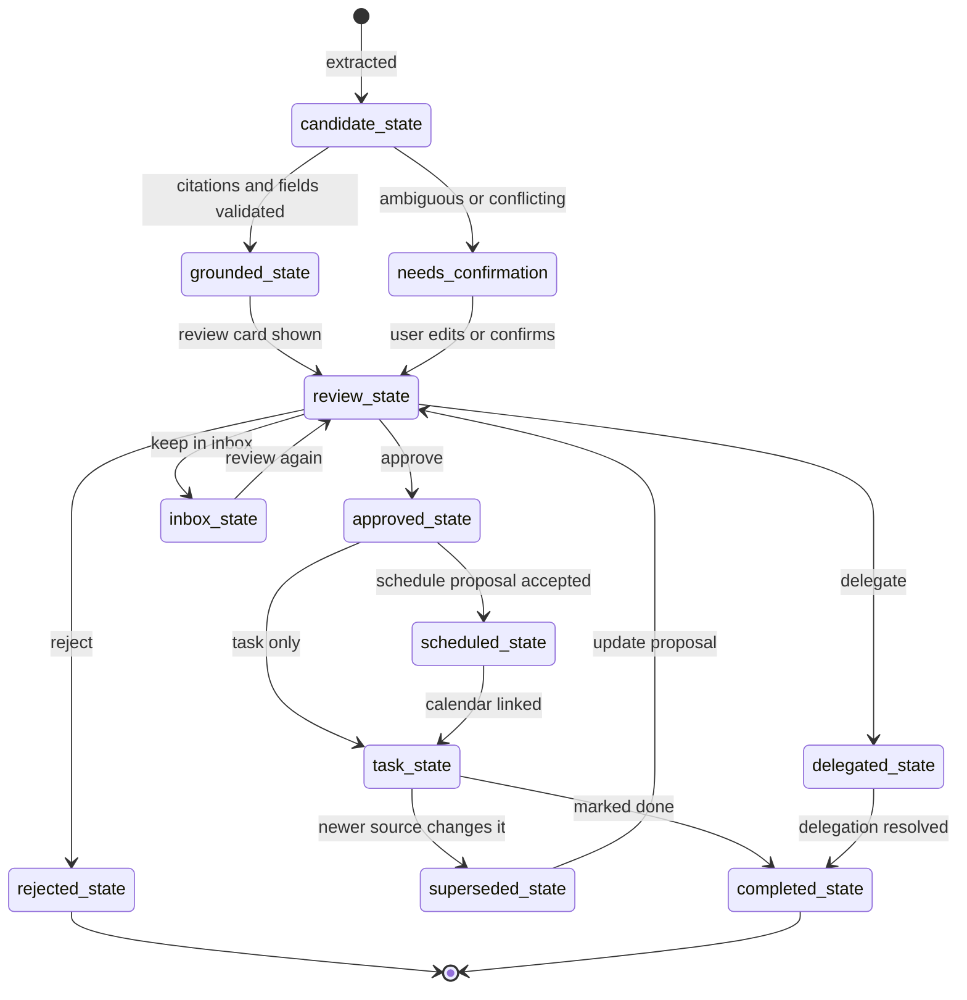

# Psychiatry HOD Desk input-to-output workflow

_End-to-end visual map of how a source becomes a cited, reviewable action and an explicit task or calendar entry._

---

## 🗺️ End-to-end map

```mermaid
flowchart LR
    accTitle: HOD Desk Input To Output
    accDescr: Every supported source passes through privacy controls, modality extraction, grounded AI retrieval and human review before it can become a task or calendar event.

    subgraph inputs["📥 Inputs"]
        whatsapp["💬 WhatsApp export or message"]
        call_audio["🎙️ Call recording or voice note"]
        screenshot["🖼️ Screenshot"]
        camera["📷 Camera photograph"]
        document["📄 PDF or Word document"]
        gmail["✉️ Gmail attachment"]
        note["📝 Typed note"]
    end

    capture["⚡ Import and fingerprint"]
    consent["🔐 Consent and source permission"]
    clinical_gate{"🔒 Clinical or sensitive?"}
    vault["🔒 Clinical vault quarantine"]
    safe_source["💾 Encrypted non-clinical source record"]

    subgraph extraction["⚙️ Modality extraction"]
        ocr["🖼️ OCR with language detection<br/>English, Tamil, Tanglish"]
        speech["🎙️ Offline speech transcription<br/>timestamps and language"]
        parse_doc["📄 Document parsing<br/>pages, headings and paragraphs"]
        normalize["🔧 Normalize text<br/>numbers, dates, names and places"]
    end

    chunk["📦 Chunk with overlap<br/>page, paragraph, message and timestamp citations"]
    candidate["🧠 Action candidate extraction<br/>sentence-local fields and intent"]
    multimodal["🧠 Multimodal EmbeddingGemma indexing<br/>text, image, audio and page vectors"]
    index_guard["🔐 Integrity gate<br/>fingerprint, model, prompt and dimension checks"]
    index["💾 Active semantic index<br/>source, passage and candidate vectors"]

    query["👤 User search or review request"]
    plan["🧠 Query planning<br/>GO numbers, people, dates, places and language"]
    hybrid["🔎 Hybrid retrieval<br/>exact, Tamil/Tanglish and semantic scores"]
    rank["🧠 Official-work ranking<br/>authority, deadline, relevance and learned preferences"]
    evidence["📚 Evidence pack<br/>strongest citations and modality locators"]
    reason["🤖 Local Gemma reasoning<br/>strict structured JSON"]
    grounding["🔐 Grounding and conflict validation<br/>quote, field, weekday and newer-source checks"]
    review_state{"✅ Safe to review?"}

    review["👤 Review card<br/>edit, approve, delegate, reject or keep in inbox"]
    correction["🔄 Correction and decision record<br/>audited local learning"]
    task["✅ Approved task<br/>owner, action, evidence and status"]
    proposal["⏰ Schedule proposal<br/>effort, travel, working hours and protected blocks"]
    calendar_review["👤 Explicit calendar confirmation<br/>accept one, accept all or reject"]
    calendar["📅 Idempotent calendar event<br/>local event linkage and reconciliation"]
    briefs["🧠 Secretary briefs<br/>morning, meeting, risk and evening views"]
    followup["📝 Editable follow-up draft<br/>English, Tamil or Tanglish"]
    send_gate["👤 Manual copy, share or send confirmation"]
    audit["🔐 Encrypted activity and performance log"]

    whatsapp --> capture
    call_audio --> capture
    screenshot --> capture
    camera --> capture
    document --> capture
    gmail --> capture
    note --> capture
    capture --> consent --> clinical_gate
    clinical_gate -->|yes| vault
    clinical_gate -->|no| safe_source
    vault -.->|excluded from ordinary search| audit
    safe_source --> ocr
    safe_source --> speech
    safe_source --> parse_doc
    safe_source --> normalize
    ocr --> normalize
    speech --> normalize
    parse_doc --> normalize
    normalize --> chunk --> candidate
    chunk --> multimodal
    candidate --> multimodal
    multimodal --> index_guard
    index_guard -->|pass| index
    index_guard -->|fail or stale| rebuild["🔄 Resumable staging rebuild"] --> index_guard

    query --> plan --> hybrid
    index --> hybrid
    hybrid --> rank --> evidence --> reason --> grounding --> review_state
    review_state -->|fail, blank field or conflict| review
    review_state -->|pass| review
    review --> correction --> task
    review -->|reject or keep| audit
    task --> proposal
    proposal --> calendar_review
    calendar_review -->|accept| calendar --> audit
    calendar_review -->|reject or revise| proposal
    task --> briefs
    briefs --> followup --> send_gate --> audit
    task --> audit
    correction --> rank

    classDef input fill:#dbeafe,stroke:#2563eb,color:#1e3a5f
    classDef secure fill:#fce7f3,stroke:#be185d,color:#831843
    classDef ai fill:#ede9fe,stroke:#7c3aed,color:#4c1d95
    classDef human fill:#fef3c7,stroke:#d97706,color:#78350f
    classDef output fill:#dcfce7,stroke:#16a34a,color:#14532d
    classDef audit_node fill:#e0f2fe,stroke:#0284c7,color:#0c4a6e

    class whatsapp,call_audio,screenshot,camera,document,gmail,note input
    class consent,clinical_gate,vault,index_guard,grounding,send_gate,audit secure
    class candidate,multimodal,plan,hybrid,rank,reason,briefs ai
    class query,review,calendar_review human
    class task,calendar,followup output
    class safe_source,index,evidence,proposal,correction audit_node
```

## 🔍 Modality detail

| Input | First extraction | Preserved evidence | Indexed representations |
| --- | --- | --- | --- |
| WhatsApp | Message text, sender and export timestamp | Message index and conversation window | Summary, passage, candidate and text vectors |
| Audio | Offline transcript plus waveform windows | Transcript timestamps and audio locator | Transcript and waveform vectors |
| Screenshot or camera | OCR plus original pixels | Image URI and OCR region | Image, OCR, region and candidate vectors |
| PDF or Word | Page, heading and paragraph parsing | Page and paragraph citation | Summary, passage, page-preview and candidate vectors |
| Gmail attachment | Attachment bytes routed through the matching parser | Message and attachment identifiers | Same representation as its underlying modality |
| Typed note | Structured text normalization | Note record and creation time | Summary, passage and candidate vectors |

## 🛡️ Safety gates

1. **Before indexing:** consent, source permissions, sensitivity classification and clinical quarantine.
2. **Before retrieval:** stale-index, model-version, prompt-version and vector-dimension checks.
3. **Before reasoning:** only top-ranked cited chunks and original modality evidence are supplied to local Gemma.
4. **Before approval:** every claimed field is re-extracted from its cited quote; conflicts remain visible and failing fields stay blank.
5. **Before mutation:** task, delegation, scheduling and calendar writes require an explicit user action.
6. **After mutation:** audit records, source links, idempotency keys and reconciliation state are persisted.

## 🔄 Output lifecycle

## 📤 User-visible outputs

- **Library:** original source, extracted text, modality label, citations and related matter links.
- **Review:** one action at a time with evidence, confidence, ambiguities, conflicts and editable fields.
- **Tasks:** approved action, owner, due information, matter, source and activity history.
- **Calendar:** only explicitly confirmed events, linked to local records and reconciled after writes.
- **Today and Secretary brief:** active, non-clinical, evidence-backed priorities with counts derived from current records.
- **Settings and AI status:** model/index versions, self-check state, processing policy, privacy controls, audit export and rollback state.

## ♻️ Feedback loop

Every edit, field confirmation, rejection, delegation, duplicate decision and schedule decision is stored locally as an audited correction. The learning profile uses only non-clinical preferences, applies confidence decay, and changes future retrieval ranking without performing any hidden action.
